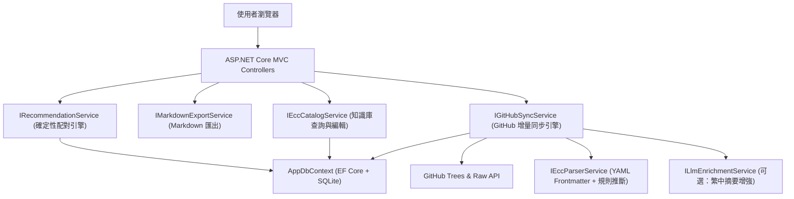
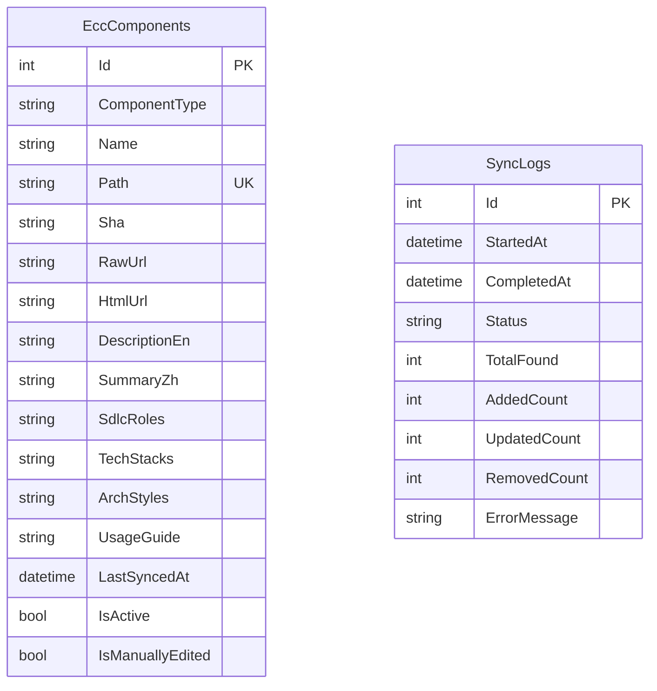
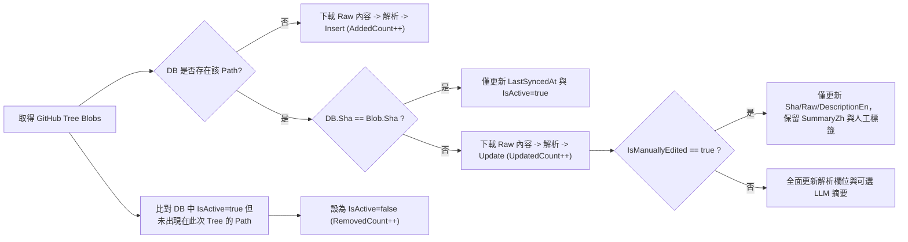

# ECCSELECTION 專案 SA/SD 系統規格書

| 項目 | 內容 |
| :--- | :--- |
| **專案名稱** | `ECCSELECTION` |
| **工作區路徑** | `D:\T01_GIT\ECCSELECTION` |
| **目標環境** | .NET 10 SDK (`10.0.100`) / ASP.NET Core MVC / SQLite / EF Core / xUnit |
| **文件狀態** | Gate 1 + v1.4 收斂推薦、Gemini 精選與運作說明規格 + v1.5 建議包內建協作治理原則 + v1.6 全站 3D 圖示視覺化（取代表格文字） |
| **變更風險等級** | **中風險**（新建獨立 MVC 專案與 SQLite 結構，無既有資料破壞風險；涉及外部 GitHub API 整合與持久化結構設計） |

---

## 一、專案目標與範圍界定

### 1.1 背景與痛點
`affaan-m/ECC`（Everything Claude Code）包含大量 `agents`、`skills`、`rules` 與 `commands` Markdown 元件。開發團隊在啟動新專案或建立 AI 輔助開發規範（Harness）時，難以針對特定的專案型態、架構風格、技術棧與 SDLC 角色快速篩選出最精準的元件組合。

### 1.2 核心目標
建立一個本地可運行、可離線查詢、可定期與 GitHub 上游同步的 **ECC 元件知識庫與智慧選型系統**：
1. **GitHub 增量同步引擎**：透過 GitHub Git Trees API 偵測 `agents`、`skills`、`rules`、`commands` 異動，僅針對新增或 `Sha` 變更的檔案下載 Raw 內容並解析入庫。
2. **SQLite 知識庫管理**：持久化儲存 ECC 元件中繼資料、中英文摘要、SDLC 角色、技術棧與架構標籤，支援瀏覽、搜尋與人工微調。
3. **互動式組建問券（Harness Wizard）**：透過確定性權重與標籤配對演算法（不依賴即時 LLM 呼叫），按 SDLC 角色產出可解釋的推薦清單，並支援匯出 Markdown 文件。

---

## 二、系統架構與分層設計

### 2.1 整體架構圖



### 2.2 方案目錄結構（Solution Layout）

```text
D:\T01_GIT\ECCSELECTION\
├── ECCSELECTION.sln
├── README.md
├── src\
│   └── ECCSELECTION.Web\
│       ├── ECCSELECTION.Web.csproj
│       ├── Program.cs
│       ├── appsettings.json
│       ├── appsettings.Development.json
│       ├── Data\
│       │   └── AppDbContext.cs
│       ├── Models\
│       │   ├── EccComponent.cs
│       │   ├── SyncLog.cs
│       │   └── Enums\
│       │       ├── ComponentType.cs
│       │       └── SyncStatus.cs
│       ├── ViewModels\
│       │   ├── WizardRequestViewModel.cs
│       │   ├── WizardResultViewModel.cs
│       │   ├── EccCatalogFilterViewModel.cs
│       │   ├── EccComponentEditViewModel.cs
│       │   └── SyncDashboardViewModel.cs
│       ├── Services\
│       │   ├── Interfaces\
│       │   │   ├── IGitHubSyncService.cs
│       │   │   ├── IEccParserService.cs
│       │   │   ├── ILlmEnrichmentService.cs
│       │   │   ├── IRecommendationService.cs
│       │   │   ├── IMarkdownExportService.cs
│       │   │   └── IEccCatalogService.cs
│       │   ├── GitHubSyncService.cs
│       │   ├── EccParserService.cs
│       │   ├── LlmEnrichmentService.cs
│       │   ├── RecommendationService.cs
│       │   ├── MarkdownExportService.cs
│       │   └── EccCatalogService.cs
│       ├── Options\
│       │   ├── GitHubSyncOptions.cs
│       │   └── LlmEnrichmentOptions.cs
│       ├── Controllers\
│       │   ├── HomeController.cs
│       │   ├── WizardController.cs
│       │   ├── CatalogController.cs
│       │   └── SyncController.cs
│       └── Views\
│           ├── Shared\
│           ├── Home\
│           ├── Wizard\
│           ├── Catalog\
│           └── Sync\
└── tests\
    └── ECCSELECTION.Tests\
        ├── ECCSELECTION.Tests.csproj
        ├── Services\
        │   ├── EccParserServiceTests.cs
        │   ├── GitHubSyncServiceTests.cs
        │   ├── RecommendationServiceTests.cs
        │   └── MarkdownExportServiceTests.cs
        └── Helpers\
            └── TestDbContextFactory.cs
```

### 2.3 設定檔契約（`appsettings.json`）

```json
{
  "ConnectionStrings": {
    "DefaultConnection": "Data Source=eccselection.db"
  },
  "GitHubSync": {
    "Owner": "affaan-m",
    "Repo": "ECC",
    "Branch": "main",
    "PersonalAccessToken": ""
  },
  "LlmEnrichment": {
    "Enabled": false,
    "Endpoint": "",
    "ApiKey": "",
    "Model": ""
  }
}
```

> [!NOTE]
> `PersonalAccessToken` 與 `LlmEnrichment.ApiKey` 皆為可選項，建議於開發環境使用 `dotnet user-secrets` 或環境變數覆寫，嚴禁將真實密鑰寫入版本控制。

---

## 三、SQLite 資料庫設計（EF Core）

### 3.1 ER 關聯與資料表定義



### 3.2 `EccComponents` 欄位與約束

| 欄位名稱 | C# 型別 | SQLite 型別 | 約束 / 說明 |
| :--- | :--- | :--- | :--- |
| `Id` | `int` | `INTEGER` | Primary Key, AutoIncrement |
| `ComponentType` | `ComponentType` (Enum -> String) | `TEXT` | 必填：`Agent` / `Skill` / `Rule` / `Command` |
| `Name` | `string` | `TEXT` | 必填，最長 200 字元 |
| `Path` | `string` | `TEXT` | 必填，**Unique Index**，Repo 內相對路徑（如 `agents/architect.md`） |
| `Sha` | `string` | `TEXT` | 必填，最長 64 字元，Git Blob SHA |
| `RawUrl` | `string` | `TEXT` | 必填，`https://raw.githubusercontent.com/affaan-m/ECC/main/{Path}` |
| `HtmlUrl` | `string` | `TEXT` | 必填，`https://github.com/affaan-m/ECC/blob/main/{Path}` |
| `DescriptionEn` | `string` | `TEXT` | 可為空字串，來自 YAML Frontmatter 或首段摘要 |
| `SummaryZh` | `string` | `TEXT` | 可為空字串，規則生成或 LLM 增強之繁體中文摘要 |
| `SdlcRoles` | `string` | `TEXT` | 以標準化逗號分隔或 JSON 陣列儲存，如 `SA,SD` |
| `TechStacks` | `string` | `TEXT` | 標準化小寫 Slug 清單，如 `dotnet,react,common` |
| `ArchStyles` | `string` | `TEXT` | 標準化小寫 Slug 清單，如 `mvc,clean,mvvm,general` |
| `UsageGuide` | `string` | `TEXT` | 觸發時機與使用方式摘要 |
| `LastSyncedAt` | `DateTime` | `TEXT` (UTC) | 最後一次同步時間 |
| `IsActive` | `bool` | `INTEGER` | 預設 `true`；若上游已刪除則軟刪除為 `false` |
| `IsManuallyEdited` | `bool` | `INTEGER` | 預設 `false`；若使用者曾手動編輯中文摘要/標籤，同步更新時保留人工欄位 |

> [!TIP]
> 多值欄位（`SdlcRoles`, `TechStacks`, `ArchStyles`）在 Domain Model 中以標準化逗號分隔字串儲存，並提供輔助方法轉為 `IReadOnlyList<string>` 進行精確 Token 比對（避免 `java` 誤匹配 `javascript`）。

### 3.3 `SyncLogs` 欄位與約束

| 欄位名稱 | C# 型別 | SQLite 型別 | 約束 / 說明 |
| :--- | :--- | :--- | :--- |
| `Id` | `int` | `INTEGER` | Primary Key, AutoIncrement |
| `StartedAt` | `DateTime` | `TEXT` (UTC) | 同步開始時間 |
| `CompletedAt` | `DateTime?` | `TEXT` (UTC) | 同步結束時間 |
| `Status` | `SyncStatus` (Enum -> String) | `TEXT` | `Running` / `Success` / `PartialSuccess` / `Failed` |
| `TotalFound` | `int` | `INTEGER` | 本次 Tree API 篩選符合規則的檔案總數 |
| `AddedCount` | `int` | `INTEGER` | 新增筆數 |
| `UpdatedCount` | `int` | `INTEGER` | `Sha` 異動更新筆數 |
| `RemovedCount` | `int` | `INTEGER` | 上游移除（設為 `IsActive = false`）筆數 |
| `ErrorMessage` | `string?` | `TEXT` | 錯誤或部分失敗摘要 |

---

## 四、GitHub 同步引擎與解析規則

### 4.1 同步流程與路徑過濾契約

1. **呼叫 GitHub Trees API**：
   - `GET https://api.github.com/repos/{Owner}/{Repo}/git/trees/{Branch}?recursive=1`
   - 必帶 Header：`User-Agent: ECCSELECTION-Sync/1.0`
   - 若 `PersonalAccessToken` 非空，帶入 `Authorization: Bearer {Token}`，避免未驗證 60 req/hr 限流。
2. **Tree Item 過濾規則**（僅處理 `type == "blob"`）：
   - `^agents/[^/]+\.md$` → `ComponentType.Agent`
   - `^skills/[^/]+/SKILL\.md$` → `ComponentType.Skill`
   - `^rules/[^/]+/[^/]+\.md$` → `ComponentType.Rule`
   - `^commands/[^/]+\.md$` → `ComponentType.Command`
   - 排除 `README.md`、`CONTRIBUTING.md` 等非元件檔案。

### 4.2 SHA 增量比對演算法



### 4.3 Markdown 與 YAML Frontmatter 解析規則（`EccParserService`）

1. **YAML Frontmatter 擷取**：
   - 若檔案以 `---` 開頭，解析至下一個 `---` 之間的 Key-Value（可使用 `YamlDotNet` 或嚴謹的行解析器）：
     - `name` → 若無則退回使用檔名（Skill 則使用上層資料夾名稱，如 `skills/tdd-workflow/SKILL.md` → `tdd-workflow`）。
     - `description` → 寫入 `DescriptionEn`；若 Frontmatter 無 `description`，擷取正文第一個非標題段落（最長 300 字元）。
2. **使用方式與觸發時機（`UsageGuide`）擷取**：
   - 優先擷取 Markdown 中標題包含 `When to Use`、`Usage`、`Trigger`、`How to Use` 的區段摘要；若為 `Command`，自動標註 `/command-name` 觸發格式。
3. **確定性標籤推斷規則**：
   - **技術棧（`TechStacks`）**：
     - 路徑規則：`rules/common/*` → `common`；`rules/python/*` → `python`；`rules/golang/*` → `go`；`rules/typescript/*` → `react,vue,typescript`；`rules/java/*` 或 `springboot` → `java`；`rules/kotlin/*` → `kotlin`；`rules/dotnet/*` 或 `csharp` → `dotnet`。
     - 關鍵字規則（比對 `Name` + `DescriptionEn` + 正文前 1500 字）：偵測 `postgres`/`postgresql` → `postgres`、`mysql` → `mysql`、`sqlite` → `sqlite`、`sql server`/`mssql` → `sqlserver`、`react` → `react`、`vue` → `vue`、`android`/`kotlin` → `kotlin`、`dotnet`/`.net`/`c#`/`ef core` → `dotnet`、`python`/`django`/`fastapi` → `python`、`golang`/`go` → `go`、`java`/`spring` → `java`。若皆無特定語言，標記 `common`。
   - **SDLC 角色（`SdlcRoles`）**：
     - 關鍵字映射表：
       - `SA`：`architect`, `plan`, `requirements`, `spec`, `design`, `system`, `prd`
       - `SD`：`architect`, `api-design`, `schema`, `database-design`, `pattern`, `clean`, `mvc`, `mvvm`
       - `PG_FE`：`frontend`, `react`, `vue`, `ui`, `css`, `accessibility`, `e2e`
       - `PG_BE`：`backend`, `api`, `dotnet`, `go`, `python`, `java`, `auth`, `security`, `service`
       - `PG_DB`：`database`, `sql`, `postgres`, `mysql`, `sqlite`, `migration`, `query`, `ef core`
       - `PG_TEST`：`tdd`, `test`, `unit`, `coverage`, `mock`, `xunit`, `pytest`
       - `QA`：`review`, `code-review`, `security-review`, `verify`, `qa`, `e2e`, `audit`
     - 若無法匹配特定角色，預設依類型給予通用角色（如 `Rule` 且含 `common` → `SA,SD,PG_FE,PG_BE,PG_DB,PG_TEST,QA`）。
   - **架構風格（`ArchStyles`）**：
     - 偵測 `mvc`、`clean`、`mvvm`；若無明確指定則標記 `general`。
4. **中文摘要（`SummaryZh`）預設生成**：
   - 若未啟用 LLM，系統依 `ComponentType`、`Name`、`SdlcRoles` 與 `DescriptionEn` 組合產生結構化繁中說明（例如：`[Agent] 架構規劃師（適用：SA, SD）— 負責系統架構設計與技術決策。`），確保知識庫在無 LLM Key 時仍具備完整可讀性。

### 4.4 可選 LLM 增強服務（`LlmEnrichmentService`）

- **非阻塞原則**：`LlmEnrichment.Enabled == false` 或 `ApiKey` 為空時，直接返回 `null`，同步流程零延遲通過。
- **降級保護**：若呼叫外部 OpenAI-compatible Endpoint 發生逾時或錯誤（單筆 Timeout 建議 15 秒），記錄 Warning 並保留規則式摘要，絕不導致整體同步失敗。

---

## 五、互動式組建問券與確定性配對邏輯

### 5.1 問券輸入規格（`WizardRequestViewModel`）與連動相容性規則（`WizardCompatibility`）

| 欄位 | 型別 | 選項值 |
| :--- | :--- | :--- |
| `ProjectType` | `string` | `Web`, `Mobile`, `API`, `Fullstack`, `Game`（遊戲開發 / Roblox / Unity / Godot） |
| `ProjectLifecycle` | `string` | `Greenfield`（新專案從零建置） / `Brownfield`（舊專案導入與重構） |
| `ArchStyle` | `string` | `MVC`, `Clean`, `MVVM`, `ECS`（遊戲物件 / Entity-Component-System） |
| `TechStacks` | `List<string>` | `dotnet`, `kotlin`, `react`, `vue`, `python`, `go`, `java`, `luau`（Roblox Luau / Lua）, `godot`（Godot / GDScript）, `cpp`, `sqlserver`, `sqlite`, `postgres`, `mysql` |
| `SdlcRoles` | `List<string>` | `SA`, `SD`, `PG_FE`, `PG_BE`, `PG_DB`, `PG_TEST`, `QA` |
| `Mode` | `string` | `Compact`（精簡核心） / `Comprehensive`（完整參考） |

為避免產出不合理之技術組合（例如 `Web` 搭配 `Kotlin / Android`、或 `API` 搭配 `PG-前端` / `React`），系統由 `WizardCompatibility` 作為前後端單一真理來源（Single Source of Truth），強制執行以下專案型態連動相容性矩陣：

| 專案型態 | 適用架構風格 (`Default`) | 適用技術棧與資料庫 (`Default`) | 適用 SDLC 角色 |
| :--- | :--- | :--- | :--- |
| `Web` | `MVC` *(預設)*, `Clean` | `dotnet` *(預設)*, `react`, `vue`, `python`, `go`, `java`, `sqlserver`, `sqlite`, `postgres`, `mysql`（排除 `kotlin`, `luau`, `godot`, `cpp`） | `SA`, `SD`, `PG_FE`, `PG_BE`, `PG_DB`, `PG_TEST`, `QA` |
| `Mobile` | `MVVM` *(預設)*, `Clean` | `kotlin` *(預設)*, `sqlite` *(預設)*（排除 Web/後端語言與遠端伺服器 DB） | `SA`, `SD`, `PG_FE`, `PG_DB`, `PG_TEST`, `QA`（排除 `PG_BE`） |
| `API` | `Clean` *(預設)*, `MVC` | `dotnet` *(預設)*, `python`, `go`, `java`, `sqlserver`, `sqlite`, `postgres`, `mysql`（排除 `kotlin`, `react`, `vue`, `luau`, `godot`） | `SA`, `SD`, `PG_BE`, `PG_DB`, `PG_TEST`, `QA`（排除 `PG_FE`） |
| `Fullstack` | `Clean` *(預設)*, `MVC` | `dotnet` *(預設)*, `react` *(預設)*, `vue`, `python`, `go`, `java`, `sqlserver`, `sqlite`, `postgres`, `mysql`（排除 `kotlin`, `luau`, `godot`, `cpp`） | `SA`, `SD`, `PG_FE`, `PG_BE`, `PG_DB`, `PG_TEST`, `QA` |
| `Game` | `ECS` *(預設)*, `Clean`, `MVC` | `luau` *(預設)*, `godot`, `dotnet`, `cpp`, `sqlite` | `SA`, `SD`, `PG_FE`, `PG_BE`, `PG_DB`, `PG_TEST`, `QA` |

- **前端互動防呆**：切換 `ProjectType` 時，不適用之架構風格、技術棧與角色選項會即時停用（`disabled` + 灰階標示）並自動取消勾選；若當前架構不適用或技術棧全空，自動切換為該型態預設值。
- **後端強制檢核**：`WizardController` 於 `Recommend` 與 `ExportMarkdown` 執行前皆呼叫 `WizardCompatibility.Validate`，拒絕不合法的跨欄位組合（含 `ProjectLifecycle` 必須為 `Greenfield` 或 `Brownfield`）。

### 5.2 確定性權重配對演算法（`RecommendationService`）與 Agent 配套套組

對所有 `IsActive == true` 的元件，針對使用者勾選的每一個目標 `role` 與 `ProjectLifecycle` 獨立計算適配分數（`Score`）並收集可解釋的 `MatchReasons`：

1. **角色過濾（必要條件）**：
   - 元件的 `SdlcRoles` 必須包含目標 `role`（或同時滿足以下條件之通用規則）。
   - 權重加分：`+40` 分，理由：`「符合角色定位：{RoleDisplayName}」`。
2. **技術棧匹配**：
   - 元件 `TechStacks` 與使用者選擇的 `TechStacks` 有交集（每命中一個 `+25` 分，上限 `+50` 分），理由：`「命中技術棧：{MatchedStacks}」`。
   - 若元件包含 `common`（通用規範）：`+15` 分，理由：`「通用工程規範（適用跨技術棧）」`。
   - **衝突排除**：若元件明確屬於某特定語言（例如僅含 `python`，不含 `common`），而使用者完全未選 `python`，則該元件**直接排除**（避免將 Python 規範推薦給純 .NET 或 Roblox 專案）。
3. **架構風格、專案型態與導入階段（`ProjectLifecycle`）匹配**：
   - 元件 `ArchStyles` 命中使用者 `ArchStyle`：`+15` 分，理由：`「符合架構風格：{ArchStyle}」`；若為 `general`：`+5` 分。
   - 專案型態輔助加權：如 `Mobile` 對 `kotlin` / `mvvm` 加 `+10` 分；`API` 對 `PG_BE` / `PG_DB` 相關元件加 `+10` 分；`Game` 對 `luau` / `godot` / `gdscript` / `gan-*` / `cpp` 加 `+15` 分。
   - 導入階段（`ProjectLifecycle`）加權：
     - `Greenfield`（新專案）：對架構規劃、TDD 起手、規格與生成類元件（如 `architect`, `planner`, `tdd-guide`, `gan-planner`, `gan-generator`, `database-reviewer`）加 `+20` 分。
     - `Brownfield`（舊專案導入）：對程式碼探索、規格反推、重構清理、既有測試與品質審計類元件（如 `code-explorer`, `spec-miner`, `refactor-cleaner`, `silent-failure-hunter`, `harness-optimizer`, `code-reviewer`, `security-reviewer`, `e2e-runner`）加 `+20` 分。
4. **以 Agent 為核心的配套套組（`HarnessSuiteViewModel`）**：
   - 系統從推薦出的核心 **Agent** 出發，依共享 `SdlcRoles`、共享 `TechStacks`、領域關鍵字親和度與 `ProjectLifecycle` 一致性，自動為每個 Agent 配對最適合的 **Skill**、**Rule** 與 **Command**，組成一整套可勾選的 Harness 套組。
   - 結果頁提供套組級與單一檔案級勾選框（Checkbox），預設全選，使用者可自由增減。
5. **精簡模式（`Compact` vs `Comprehensive`）**：
   - 排序依據：`Score` 降冪 → `ComponentType` 優先序（`Agent` → `Rule` → `Skill` → `Command`）→ `Name` 升冪。
   - `Compact`（精簡核心）：每個 SDLC 角色僅取分數最高之前 **3~5** 項（且 `Score >= 50`），每個 Agent 套組嚴格收斂配對 **最多 2 Skill、2 Rule、1 Command**（且 `pairScore >= 50`，必須命中技術棧、領域關鍵字或需求關鍵字，避免純通用項目湊數）。
   - `Comprehensive`（完整參考）：每個 SDLC 角色取前 **10~15** 項（`Score >= 40`），每個 Agent 套組最多 **3 Skill、3 Rule、2 Command**。
   - **候選延伸清單（`AdditionalCandidates`）**：未進入預設精選核心但分數達標之元件，保留於結果頁「其他候選項目（可手動加勾）」摺疊區塊，預設不勾選，由使用者自由加選。

### 5.3 推薦結果頁面、勾選與真實檔案 ZIP 下載（`HarnessBundleService`）

- 推薦結果頁面同時呈現 **「以 Agent 為核心的配套套組（預設檢視）」** 與 **「依 SDLC 角色分組清單」**，每個元件皆附有勾選框。
- 使用者勾選完成後，點擊上方 **「下載勾選的 Harness 套件 (.zip)」**（`POST /Wizard/DownloadBundle`）：
  - 後端依勾選的 `SelectedComponentIds`（去重）讀取資料庫中之 `RawUrl` 與 `LocalSuggestedPath`。
  - 透過 `HttpClient` 從 GitHub Raw URL 下載實際檔案內容，並依建議路徑（如 `.claude/agents/architect.md`、`.claude/skills/tdd-workflow/SKILL.md`、`.claude/rules/...`、`.claude/commands/...`）打包為 `ecc-harness-bundle.zip` 供使用者直接解壓縮至專案根目錄使用。
  - 若選中 `Skill` 元件，系統透過 GitHub Git Trees API 偵測該 Skill 資料夾（`skills/{skill-name}/`）底下的附屬輔助檔（如 `references/`、`scripts/`、`examples/`、`resources/` 等），一併下載並打包至對應目錄（若 Trees API 失敗或限流則非阻塞降級，仍保留 `SKILL.md`）。
  - 若個別檔案下載失敗，記錄日誌並在 ZIP 內附註 `DOWNLOAD_ERRORS.txt`，不靜默吞錯。
- 保留「匯出推薦摘要 (.md)」作為輔助文件匯出。

### 5.4 v1.3 需求文件解析、專案參數與防堵卡點（Guardrails）組建

1. **需求用途與文件解析（`IRequirementAnalyzerService` / `RequirementAnalyzerService`）**：
   - 使用者可於 `/Wizard` 填寫 `ProjectPurpose`（用途與需求說明文字）並上傳需求文件 `RequirementDocument`（支援 `.md`, `.txt`, `.json`, `.yaml`, `.yml`, `.csv`, `.xml`，單檔上限 2 MB，拒絕未允許副檔名與二進位檔）。
   - `RequirementAnalyzerService` 採**混合式深度分析（LLM 優先 + 確定性非阻塞降級）**：
     - 當 `LlmEnrichment.Enabled == true` 且設定 `Endpoint` 與 `ApiKey` 時，呼叫 OpenAI-compatible API 進行語意深度分析，推斷專案型態、生命週期、架構風格、技術棧、SDLC 角色、建議專案名稱、擴充英文檢索關鍵詞，以及**自動產出工程組建參數**（`TargetEnvironment`、`BuildCommand`、`FormatCommand`、`TestCommand`、`SecurityScanCommand`），並經由 `WizardCompatibility` 強制校驗合法性。
     - 若未設定 LLM 或呼叫逾時/失敗（15 秒 Timeout），自動非阻塞降級為確定性規則與關鍵字解析（依技術棧自動推斷對應環境與建置/測試指令），並於 `AnalysisSource` 標註實際使用模式。
   - `POST /Wizard/AnalyzeRequirements`（AJAX/表單輔助）或於 `Recommend` 提交時自動解析並將 `ExtractedKeywords` 納入 `RecommendationService` 權重計算：
     - 元件的 `Name`、`DescriptionEn`、`SummaryZh`、`UsageGuide`、`TechStacks` 命中需求關鍵字時，每個關鍵字加 `+8` 分（上限 `+32` 分），並於 `MatchReasons` 標註 `「命中需求關鍵字：{Keywords}」`。

2. **專案組建參數與防堵卡點選項（`HarnessAssemblyOptionsViewModel`）**：
   - 使用者僅需填寫直覺的基本資訊（`ProjectName`、`SpecFilePath`、`DevServerUrl`、`TargetPlatform`）與防堵卡點開關；其餘工程指令（`TargetEnvironment`、`BuildCommand`、`FormatCommand`、`TestCommand`、`SecurityScanCommand`、`ScopeGuardNote`、`ProtectedPaths`）由系統／LLM 依需求與技術棧**自動產出**，並收納於可收合的「進階工程參數」區塊供進階使用者檢視或微調：
     - `ProjectName`（專案名稱，預設 `MyProject`）
     - `TargetEnvironment`（目標環境說明，如 `.NET 10 / ASP.NET Core MVC`）
     - `SpecFilePath`（規格書路徑，預設 `SPEC.md`）
     - `BuildCommand`（建置指令，依專案技術棧提供合理預設，如 `dotnet build -warnaserror`）
     - `FormatCommand`（格式檢查指令，如 `dotnet format --verify-no-changes --no-restore`）
     - `TestCommand`（測試指令，如 `dotnet test --no-build --verbosity normal`）
     - `SecurityScanCommand`（安全掃描指令，預設 `npx --yes ecc-agentshield scan --path . --format text`）
     - `DevServerUrl`（實機驗證網址，可選，如 `http://localhost:5109`）
     - `ScopeGuardNote`（架構邊界與異動範圍限制說明，預設 `僅限專案原始碼與測試目錄，禁止未授權修改部署與憑證設定`）
     - `ProtectedPaths`（受保護／禁止 AI 直接覆寫的敏感路徑清單，預設 `.env*,**/*.pem,**/*.key,**/secrets.*,appsettings.Production.json`）
     - `TargetPlatform`（目標 AI Harness 平台：`All` / `Antigravity` / `ClaudeCode`，預設 `All`）
   - **防堵卡點（Guardrail Gates）開關**（預設全數啟用）：
     - `RequireSpecFirst`：未更新 `{SpecFilePath}` 前禁止實作核心功能。
     - `RequireTestsBeforeDone`：強制 TDD / 單元測試與品質閘門全綠，未通過禁止宣告完成。
     - `RequireEvidenceOutput`：強制證據輸出契約（必須附上各項指令實測結果，禁止口頭宣稱已檢查）。
     - `IncludeGitPreCommitHook`：於 ZIP 產出 `.githooks/pre-commit` 與 `scripts/install-hooks.ps1` / `scripts/install-hooks.sh`，在 `git commit` 前強制攔截格式/建置/密鑰違規。
     - `IncludeIdeAutoRules`：於 ZIP 產出自動載入的根目錄規範 `AGENTS.md`、`CLAUDE.md`、`.agents/rules/workflow-guardrails.md`、`.claude/settings.json`（含 Hook 防堵設定）與可執行品質閘門 `scripts/quality-gate.ps1` / `scripts/quality-gate.sh`。

3. **防堵卡點組建輸出契約（`HarnessBundleService.BuildBundleZipAsync`）**：
   - 除了原本從 GitHub 下載的 `.claude/{agents,skills,rules,commands}/...`（當 `TargetPlatform` 為 `All` 或 `Antigravity` 時亦同步鏡像至 `.agents/` 或 `.ecc/`），若啟用防堵卡點與專案參數，ZIP 套件必須直接組建並包含：
     - `AGENTS.md` 與 `CLAUDE.md`（嵌入專案參數、已選元件清單、不可繞過的 4 道 HARD GATES 與證據輸出契約）。
     - `.agents/rules/workflow-guardrails.md`（供 IDE/Agent 自動載入的工作流強制規則）。
     - `.claude/settings.json`（Claude Code 原生 `permissions.deny` 敏感路徑阻擋規則 + `PreToolUse` / `Stop` Hooks 防堵設定）。
     - `scripts/quality-gate.ps1` 與 `scripts/quality-gate.sh`（依使用者填入的 `BuildCommand`、`FormatCommand`、`TestCommand`、`SecurityScanCommand` 組建，任一步驟失敗即非零結束碼阻擋）。
     - `.githooks/pre-commit`、`scripts/install-hooks.ps1`、`scripts/install-hooks.sh`（Git 提交前卡點）。
     - `HARNESS_PLAYBOOK.md` & `README_HARNESS.md`（客製化 Harness 運作說明書：SDLC 工作動線、角色/指令觸發時機、自動生效規範與防堵卡點說明）。

### 5.5 v1.4 Gemini 精挑細選（API 自動模式 ＋ Chrome 網頁版接力模式）

1. **兩階段漏斗架構（`IGeminiCurationService` / `GeminiCurationService`）**：
   - **Stage 1**：`RecommendationService` 確定性初篩出相容的 Top 35 候選元件。
   - **Stage 2A（Gemini API 背景自動精選）**：支援原生 Gemini REST API（`https://generativelanguage.googleapis.com/v1beta/models/{model}:generateContent`）與 OpenAI-compatible 端點，將需求描述與 Top 35 候選摘要送交 Gemini，回傳精選元件 ID 清單、各元件入選理由、以及客製化 `HarnessPlaybookMarkdown`。若未設定 Key 或失敗，非阻塞降級為確定性收斂結果與規則式 `HARNESS_PLAYBOOK.md`。
   - **Stage 2B（Chrome Gemini 網頁版接力模式）**：因瀏覽器同源政策與 Google 登入隔離，無法從本機或 GitHub 靜態站背景代理呼叫 `gemini.google.com`，系統提供「一鍵複製精選 Prompt 並開啟 `https://gemini.google.com/app`」及「貼回 Gemini JSON 回覆套用」端點（`POST /Wizard/ApplyGeminiCuration`），讓無 API Key 的使用者也能直接使用 Chrome 上已登入的 Gemini 完成精選。
   - **API Key 引導與本機設定**：於 `/Wizard` 提供 Google AI Studio（`https://aistudio.google.com/apikey`）免費取得 Key 之引導步驟，並提供 `POST /Wizard/SaveGeminiKey`（僅寫入本機 `appsettings.Development.json` 或記憶體/本機設定，該檔已列入 `.gitignore` 嚴禁入版控）。

### 5.6 v1.5 建議包內建多代理協作與治理原則（新手導向與防跳步規範）

為讓下載 ECC 建議包（`.zip`）的新手開發者解壓縮後即可直接獲得完整的 AI 開發協作紀律，避免 AI 未經確認便直接改寫程式碼或略過審查與測試步驟，`HarnessBundleService.BuildBundleZipAsync` 必須將「多代理協作與開發治理原則」直接內建於打包產物中（不新增額外問券開關，預設隨套件自動寫入）。

1. **核心治理原則（必須寫入建議包之三大支柱）**：
   - **原則一：專責協調員監控 ＋ 專業 Agent 職責與寫入邊界隔離**
     - 主 Agent 僅擔任「專責協調員（Coordinator）」，負責需求拆解、派發子代理、監控進度、驗收與彙報，**不得越權直接修改業務程式碼、測試或規格**。
     - 每個任務依職責指派對應專責 Agent，且各角色**僅可寫入自己負責的範圍，對其他 Agent 負責的內容一律唯讀**：
       | 角色 | 允許寫入範圍 | 唯讀邊界（嚴禁修改） |
       | :--- | :--- | :--- |
       | **專責協調員（Coordinator）** | 無（僅協調、派發、監控、驗收） | 所有規格、業務程式碼、測試與設定 |
       | **SA / 規格 Agent（`planner` / `architect`）** | 規格文件（`{SpecFilePath}`） | 正式程式碼、測試目錄、設定檔 |
       | **後端實作 Agent** | 後端商業邏輯、資料模型、資料存取、服務層 | 規格文件、前端視圖/控制器、測試目錄 |
       | **前端 / MVC Agent** | 控制器、視圖、前端頁面與靜態資源 | 規格文件、後端核心服務、測試目錄 |
       | **測試 Agent（`tdd-guide`）** | 測試專案 / 測試目錄 | 規格文件、正式業務程式碼 |
       | **審查與驗證 Agent（`code-reviewer` / `security-reviewer` / `e2e-runner`）** | 無（全專案唯讀，僅執行審查、品質閘門與實機驗證） | 全專案所有檔案 |
       | **文件同步 Agent** | 進度與驗證文件（如 `DEVELOPMENT_STATUS.md`） | 規格文件、正式程式碼、測試目錄 |
     - 若目標工具或專案規模未啟用多代理子派發，單一 AI 仍須嚴格遵守「階段隔離與先唯讀後寫入」紀律，禁止同一回合未經確認混改規格與程式碼。
   - **原則二：SA / 規格先行 ＋ 人類確認閘門（Human-in-the-Loop）**
     - 任何需求或規則異動，必須先由 SA 產出或更新 `{SpecFilePath}`，完成後**必須暫停並向人類開發者呈報規格摘要，取得人類明確確認後才可進入實作階段**；嚴禁 AI 自行假設已確認並往下寫程式。
   - **原則三：強制完整流程（嚴禁跳步）**
     - 每項任務必須完整依序走完以下 7 個階段，**禁止任何 AI 自行判斷略過任何步驟**：
       `1. SA 規格先行` → `2. 人類確認閘門（強制暫停）` → `3. 分層實作` → `4. TDD 與測試覆蓋` → `5. 程式碼與安全審查` → `6. 強制品質閘門（scripts/quality-gate + 實機驗證）` → `7. 文件同步`。

2. **建議包檔案寫入契約（`HarnessBundleService`）**：
   - **`AGENTS.md` 與 `CLAUDE.md`**（於 `IncludeIdeAutoRules == true` 時依 `TargetPlatform` 產出，由 `BuildGuardrailMarkdown` 統一組建）：
     - 新增首要章節 `## 多代理協作與開發治理原則（Coordinator ＋ 寫入邊界隔離）`，完整嵌入上述三大原則、角色寫入邊界矩陣表、7 步強制完整流程與 `{SpecFilePath}` 路徑。
     - 於原有 `Gate 1：規格先行卡點`（當 `RequireSpecFirst == true` 時）補充「更新 `{SpecFilePath}` 後必須暫停並取得人類明確確認，方可進入實作」之強制條文。
     - 新增 `### 給新手的協作操作指引` 小節，以白話 3 步驟向開發者說明：「(1) 下達需求後 AI 會先更新規格並停下來等你確認；(2) 確認規格無誤後回覆同意實作，AI 才會分層開發與補測試；(3) 最後須附上品質閘門實測結果才算完成」。
   - **`.agents/rules/workflow-guardrails.md`**（於 `IncludeIdeAutoRules == true` 且 `TargetPlatform` 為 `All` 或 `Antigravity` 時產出，由 `BuildAntigravityAutoRule` 組建）：
     - 以精簡條列式寫入自動載入規則：強制「專責協調員＋寫入邊界隔離」、「SA 更新 `{SpecFilePath}` 後人類確認閘門（強制暫停）」以及「7 步完整流程（嚴禁跳步）」。
   - **`README_HARNESS.md`**（永遠產出，不受 `IncludeIdeAutoRules` 開關影響）：
     - 在「一鍵啟用步驟」之後新增 `## 給新手的 AI 協作與治理原則（快速上手指南）` 區塊，用淺顯說明介紹「專責協調員＋寫入邊界隔離」、「規格先行＋人類確認閘門」與「7 步完整流程」，確保使用者即使停用 IDE 自動載入規則，下載的建議包內依然具備完整指引。

3. **後端與前端影響範圍**：
   - **後端（`HarnessBundleService`）**：僅需更新 `BuildBundleZipAsync`（`README_HARNESS.md` manifest 組裝）、`BuildGuardrailMarkdown` 與 `BuildAntigravityAutoRule`；無需新增 `HarnessAssemblyOptionsViewModel` 欄位，亦無需變動 `IHarnessBundleService` 或 `WizardController.DownloadBundle` 方法簽章。
   - **前端（`Views/Wizard/Index.cshtml`、`Views/Wizard/Result.cshtml`）**：微調 `IncludeIdeAutoRules` 勾選框的標籤／說明文字，明確提示套件內已包含「多代理協調員＋寫入邊界隔離、人類確認閘門與 7 步完整流程」新手治理規範，提升使用者對套件價值的辨識度。

---

## 六、MVC 頁面與控制器規劃

| Controller | Action | 職責說明 |
| :--- | :--- | :--- |
| `HomeController` | `Index` | 系統首頁與 3D 立體空間儀表板（3D 類型計數立方柱、3D 同步狀態燈塔、快速進入問券） |
| `WizardController` | `Index` (GET) | 顯示 3D 圖示化互動式組建問券表單（3D 觸控方塊選項取代傳統下拉與文字清單） |
| `WizardController` | `Recommend` (POST) | 執行 `IRecommendationService`，顯示以 3D 積木卡呈現的 Agent 套組與 SDLC 角色推薦結果 |
| `WizardController` | `ExportMarkdown` (POST) | 產出並下載 `ecc-harness-recommendation.md`（`text/markdown`） |
| `CatalogController` | `Index` (GET) | 知識庫 3D 元件卡片網格瀏覽、關鍵字搜尋、依 `ComponentType` / `SdlcRole` / `TechStack` 篩選 |
| `CatalogController` | `Details` / `Edit` (GET/POST) | 檢視元件完整資訊與編輯 `SummaryZh`、`SdlcRoles`、`TechStacks`、`ArchStyles`（更新時設定 `IsManuallyEdited = true`） |
| `SyncController` | `Index` (GET) | 顯示 3D 同步時間軸卡片紀錄與環境狀態燈塔（Token 是否已設定、LLM 是否啟用） |
| `SyncController` | `Trigger` (POST) | 手動觸發 `IGitHubSyncService.SyncAsync()` 並導回結果通知 |

### 6.1 v1.6 全站 3D 圖示視覺化規範（取代表格文字）

為降低閱讀大量表格文字的認知負擔，全站全面取消傳統 `<table>` 與長篇文字列表，改以 **「CSS 3D Transform 立體景深 ＋ 內聯等距 3D SVG 圖示庫 ＋ 互動式詳情提示」** 作為統一視覺語言，讓使用者透過圖示形狀、色彩、深度與能量條即可直覺判讀系統狀態與推薦結果。

#### 1. 技術選型與資源邊界（MVC 友善、離線可用）
- **純前端輕量架構**：採用原生 CSS 3D（`perspective`、`transform-style: preserve-3d`、多層等距陰影與高光漸層）搭配內聯等距 **3D SVG 圖示元件庫**（Razor Partial View `Views/Shared/_Icon3D.cshtml`），不引入重型 SPA 框架或外部 CDN 依賴，確保離線與現有 ASP.NET Core MVC 表單機制 100% 相容。
- **新增靜態與共用檔案**：
  - `src/ECCSELECTION.Web/wwwroot/css/icon3d.css`：3D 卡片景深、翻轉/浮起微動效、3D 能量條與無障礙降級樣式。
  - `src/ECCSELECTION.Web/wwwroot/js/icon3d.js`：3D 卡片點擊展開/翻轉詳情、Tooltip 觸發與 3D 觸控方塊選項狀態同步。
  - `src/ECCSELECTION.Web/Views/Shared/_Icon3D.cshtml`：依類型/狀態/技術棧/角色輸出對應等距 3D SVG 圖示。
- **後端零破壞原則**：現有 `Controllers/`、`Services/`、`Models/` 與 `ViewModels/` 資料契約無需結構性異動，完全沿用既有欄位（`ComponentType`、`SyncStatus`、`Score`、`IsManuallyEdited`、`IsActive`、`SdlcRoles`、`TechStacks`、`MatchReasons`、`UsageGuide`）映射至 3D 視覺元件。

#### 2. 3D 圖示視覺語言系統（3D Iconography System）
- **四大元件類型 3D 圖騰（ComponentType）**：
  - `Agent`：3D 藍紫漸層神經核心立方體（Neural Core Cube）。
  - `Skill`：3D 翡翠綠雙齒輪／工作流棱鏡（Workflow Prism）。
  - `Rule`：3D 琥珀金防禦盾牌（Guardrail Shield）。
  - `Command`：3D 青藍立體終端機鍵帽（3D Keycap）。
- **狀態與治理 3D 徽章**：
  - 同步狀態：`Success`（3D 綠寶石核取球體）、`PartialSuccess`（3D 琥珀警示錐）、`Running`（3D 旋轉軌道環）、`Failed`（3D 紅寶石斷裂盾）。
  - 元件狀態：`IsManuallyEdited == true`（3D 金色鎖頭徽章）、`IsActive == false`（3D 灰階半透明封存箱）。
  - 專案型態／架構／技術棧／SDLC 角色：皆配置對應等距 3D 迷你圖示（如 Web 立體視窗、Mobile 3D 手機、API 3D 伺服器節點、Game 3D 搖桿方塊、資料庫 3D 圓柱體等）。
- **3D 適配度能量儀表（3D Score Gauge）**：
  - 取代純文字 `Score` 欄位，以立體分段能量條與色彩光暈呈現（`>= 80` 翠綠強光、`60~79` 靛藍、`40~59` 琥珀），搭配極簡數字角標。

#### 3. 各頁面 3D 圖示取代規劃

| 頁面 (`Views/`) | 原本表格／文字呈現 | 3D 圖示視覺化改造方案 |
| :--- | :--- | :--- |
| `Shared/_Layout.cshtml` | 純文字導覽列與同步按鈕 | 導覽項目加上迷你 3D 圖示徽章，全站載入 `icon3d.css` / `icon3d.js` 與統一深淺景深背景。 |
| `Home/Index.cshtml` | 4 個純數字統計卡、純文字最近同步卡與環境狀態列 | **3D 空間儀表板**：4 大元件改為「3D 懸浮等距計數立方柱」（hover 具 3D 傾角）；環境狀態與同步狀態改為「3D 狀態燈塔（Telemetry Pods）」，以 3D 鑰匙（Token）、3D 大腦（LLM）與 3D 脈衝環直覺顯示啟用狀態。 |
| `Catalog/Index.cshtml` | 6 欄 `<table class="table">` 顯示元件類型、路徑、角色、技術棧與長篇中文摘要 | **移除 `<table>`**，改為 **3D 元件卡片網格（Tile Grid）**：每張卡片顯示 3D 類型圖騰＋人工鎖定/下架 3D 徽章、名稱、Role/Tech 3D 圖示膠囊；繁中摘要預設收斂為 2 行極簡預覽，完整摘要與路徑收納於點擊展開的詳情抽屜/Tooltip；操作改為 3D 圖示按鈕（編輯、Raw）。 |
| `Catalog/Edit.cshtml` | 純文字標題與表單欄位 | 標題區加入大型 3D 類型圖騰與 3D 人工保護盾牌視覺指示，表單輸入與 `[ValidateAntiForgeryToken]` 提交機制維持不變。 |
| `Sync/Index.cshtml` | 9 欄 `<table class="table">` 顯示最近 20 筆同步紀錄與上方 2 張純文字狀態卡 | **移除 `<table>`**，改為 **3D 同步時間軸卡片流（3D Sync Timeline）**：每筆紀錄以橫向 3D 卡片呈現（左側 3D 狀態球體節點＋時間；中間以 4 顆 **3D 迷你計數柱** 視覺化呈現掃描總數、新增 `+N`、更新 `~N`、下架 `-N`；僅在有 `ErrorMessage` 時顯示可點擊展開的紅色 3D 警示膠囊）。 |
| `Wizard/Index.cshtml` | `<select>` 下拉選單、純文字技術棧/角色方塊、防堵卡點文字清單 | 將專案型態、導入階段、架構風格、推薦模式升級為 **3D 觸控圖示選擇方塊（3D Tactile Selector Tiles）**；技術棧、SDLC 角色與防堵卡點（Hard Gates）升級為 **3D 凸起按壓方塊**（選中亮起浮起、不適用呈灰階凹陷鎖定），底層保留既有欄位名稱與 `WizardCompatibility` JS 連動防呆。 |
| `Wizard/Result.cshtml` | 3 個主要 `<table>`（Suite 配對表、候選延伸表、SDLC 角色分組表）與大段文字 Playbook `<pre>` | **全面移除 3 個 `<table>`**，改為 **3D 模組積木卡片（3D Harness Module Cards）**：Lead Agent 為 3D 主機核心卡，底下以連線網格排列配對的 Skill/Rule/Command 3D 積木卡（顯示 3D 類型圖騰、名稱、3D 適配度能量條、3D 勾選框與精簡理由圖示膠囊）；完整 `MatchReasons`、`UsageGuide`、`LocalSuggestedPath` 收納於 **點擊翻轉／展開詳情面板與懸浮 Tooltip**。Playbook 改為 3D 流程圖解摘要條＋可摺疊 Markdown 原始碼。 |

#### 4. 無障礙、互動與相容性契約
- **可讀性與輔助提示（Accessibility & Progressive Disclosure）**：所有 3D 圖示與圖示膠囊必須具備 `aria-label`、`title` 或懸浮 Tooltip，並保留「點擊卡片展開完整文字詳情」機制，確保不依賴大量表格文字亦能取得完整技術路徑與理由。
- **減弱動態偏好（Reduced Motion）**：透過 `@media (prefers-reduced-motion: reduce)` 自動關閉 3D 旋轉與懸浮彈跳動畫，僅保留靜態立體邊框與陰影。
- **既有 DOM 與表單契約保留**：`Wizard/Result.cshtml` 必須保留 `.component-checkbox`、`.suite-master-checkbox`、`data-component-id`、`data-suite-item`、`selectedComponentIds`；`Wizard/Index.cshtml` 必須保留 `data-stack-card`、`data-role-card` 與 `WizardCompatibility` 連動目標 ID，確保勾選統計、`DownloadBundle` 與 `ExportMarkdown` 功能完全不受影響。

---

## 七、Scope Guard 清單（嚴格邊界控制）

| 類別 | 允許範圍 | 禁止範圍 |
| :--- | :--- | :--- |
| **檔案建立與修改** | 僅限 `D:\T01_GIT\ECCSELECTION\` 目錄內之 `.sln`、`ECCSELECTION.Web`、`ECCSELECTION.Tests`、`README.md` 與 `.gitignore` | 嚴禁修改 `D:\T01_GIT\ECCSELECTION\` 以外的任何專案檔案或全域系統設定 |
| **資料庫** | 專案內本地 SQLite 檔案 `eccselection.db`（EF Core Code-First / `EnsureCreated` 或 `Migrate`） | 不得連線或修改外部資料庫 |
| **外部網路** | 僅限 `api.github.com`、`raw.githubusercontent.com` 及使用者顯式設定之 LLM Endpoint | 嚴禁於單元測試中發起真實外部 HTTP 請求（測試須使用 Mock `HttpMessageHandler`） |

---

## 八、測試防線與驗收標準

### 8.1 單元測試計畫（`ECCSELECTION.Tests`）
1. **`EccParserServiceTests`**：
   - 驗證含 YAML Frontmatter 與無 Frontmatter 的 Markdown 解析。
   - 驗證 `agents`、`skills`、`rules`、`commands` 的名稱與路徑推斷。
   - 驗證技術棧、SDLC 角色、架構風格推斷準確性。
2. **`GitHubSyncServiceTests`**：
   - 使用假 `HttpMessageHandler` 模擬 GitHub Tree API 與 Raw 下載：
     - 初次同步：正確新增（`AddedCount`）。
     - 二次同步（`Sha` 未變）：不重複下載 Raw、`UpdatedCount == 0`。
     - `Sha` 變更：僅下載變更檔案，且若 `IsManuallyEdited == true` 保留人工中文摘要。
     - 上游移除檔案：標記 `IsActive = false`、`RemovedCount == 1`。
3. **`RecommendationServiceTests`**：
   - 驗證「.NET + MVC + SA/PG_BE/PG_DB」問券條件能命中相關元件且排除純 Python/Go 專屬元件。
   - 驗證 `Compact` 與 `Comprehensive` 模式的數量與分數門檻差異。
   - 驗證 `MatchReasons` 非空且準確反映命中條件。
4. **`MarkdownExportServiceTests`**：
   - 驗證匯出 Markdown 包含問券條件摘要、SDLC 角色分組標題、標準表格欄位與 Raw URL。
5. **`HarnessBundleServiceTests`**（含 v1.5 協作治理原則驗收）：
   - 驗證啟用 `IncludeIdeAutoRules` 且 `TargetPlatform = "All"` 時，ZIP 內產出之 `AGENTS.md` 與 `CLAUDE.md` 皆包含「專責協調員」、「寫入邊界隔離」、「人類確認閘門」、`SpecFilePath` 以及完整 7 步流程（「SA 規格 → 人類確認 → 分層實作 → TDD 測試 → 審查與品質閘門 → 實機驗證 → 文件同步」）與新手操作指引。
   - 驗證 `.agents/rules/workflow-guardrails.md` 包含協調員寫入邊界隔離、人類確認閘門與嚴禁跳步規則。
   - 驗證 `README_HARNESS.md`（即使 `IncludeIdeAutoRules = false`）仍包含「給新手的 AI 協作與治理原則」指引區塊。

### 8.2 端到端驗收標準（Gate 2 核對基準）
1. **編譯與測試**：於 `D:\T01_GIT\ECCSELECTION` 執行 `dotnet build` 與 `dotnet test`，結果為 **0 錯誤、全數測試通過**。
2. **真實 GitHub 同步驗證**：啟動 Web 專案並觸發同步，成功從 `affaan-m/ECC` 寫入 `EccComponents` 與 `SyncLogs`（`Status == Success`、`TotalFound > 0`），且二次同步時 `AddedCount == 0`、`UpdatedCount == 0`。
3. **問券與匯出驗證**：操作 Harness Wizard 提交問券，成功產出以 3D 模組積木卡呈現的推薦結果（無傳統 `<table>`），支援 Suite 與單一元件勾選統計、點擊展開/懸浮詳情提示，並可下載有效之 `.zip` 套件與 `.md` 推薦清單。
4. **知識庫與同步管理驗證**：於 `/Catalog` 可透過 3D 元件卡片網格依類型、角色、技術棧篩選並編輯儲存元件中文摘要；於 `/Sync` 可透過 3D 時間軸卡片檢視同步狀態與計數柱。
5. **3D 視覺與無障礙驗證**：於 `http://localhost:5109` 實機驗證各頁面皆無殘留 `<table>` 標籤（`Home`、`/Catalog`、`/Sync`、`/Wizard`、`/Wizard/Recommend`），且 3D 圖示清晰、無排版溢位，表單提交與連動防呆正常運作。
